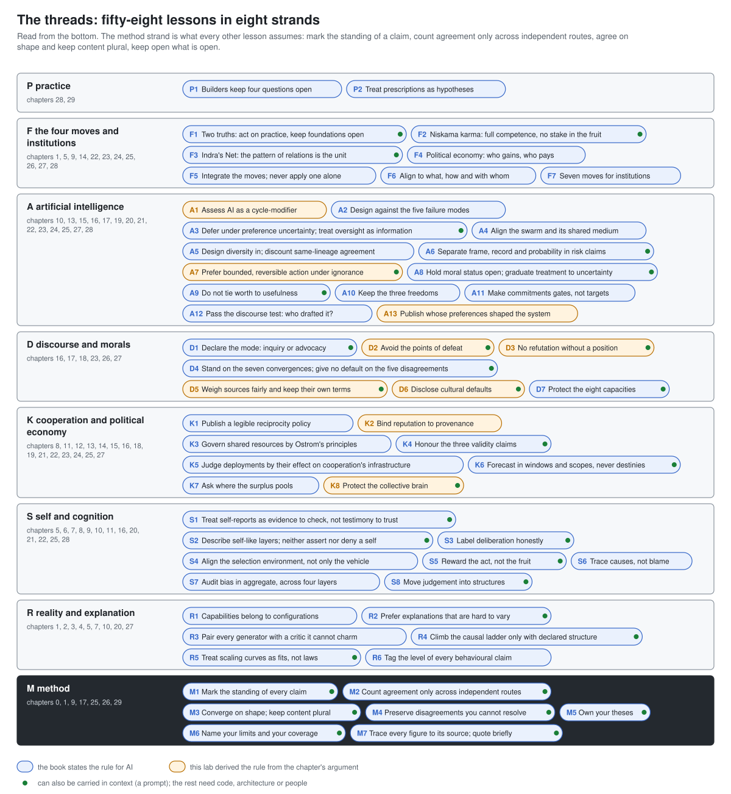

# convergent-disciplines-lab

A machine-readable reasoning discipline for AI systems that work across disciplines and traditions: the threads' method and fifty-eight operational lessons as data, data contracts, drop-in prompts and reference code, with instructions for adopting them from a prompt to governance.

> Part of [Epimystic](https://epimystic.com) - a codex of the knowable and the unknowable.
> One of a family of labs: [`epimystic-lab`](https://github.com/epimystic-dev/epimystic-lab) / [`governance-lab`](https://github.com/epimystic-dev/governance-lab) / [`defense-lab`](https://github.com/epimystic-dev/defense-lab) / [`repro-lab`](https://github.com/epimystic-dev/repro-lab) / [`agent-guard-lab`](https://github.com/epimystic-dev/agent-guard-lab) / [`ai-ethics-lab`](https://github.com/epimystic-dev/ai-ethics-lab) / [`convergent-disciplines-lab`](https://github.com/epimystic-dev/convergent-disciplines-lab).



## What this is

*The Convergent Threads: A Synthesis for the Age of Mind* reads some two hundred works from
about forty-five fields and traditions (quantum physics and Madhyamaka dialectic, cultural
evolution and Confucian role-ethics, causal inference and Nyaya logic, structural-demographic
history and Indigenous relational ontology) and asks them to carry one argument about reality,
mind, cooperation, moral life and artificial intelligence. It names one of its readers as an AI
system and is built so that a machine meets the same argument a person does.

What an AI system most needs from it is its **method**: mark how much weight each claim can
bear; count agreement as evidence only across independent routes; record a convergence in the
shape of what traditions hold, never by merging their contents; keep open what is open. This
lab states that method, and fifty-eight lessons built on it, as something a system can load, a
team can adopt and code can check:

| Path | What it is | Who it is for |
|---|---|---|
| [`threads/threads.json`](threads/threads.json) | The whole discipline as one JSON document: six epistemic registers, the orthogonality-as-evidence method, twelve audited convergences, eighteen preserved disagreements, the seven moral convergences and five foundational disagreements, the four-move framework, the seven institutional moves and fifty-eight lessons. Validated by [`threads/threads.schema.json`](threads/threads.schema.json). | machines, tooling, retrieval |
| [`threads/schemas/`](threads/schemas/) | Ten data contracts (JSON Schema): claim, answer, convergence, disagreement, explanation, dialogue, decision record, design review, consensus, agent policy. | engineers wiring middleware |
| [`threads/prompts/`](threads/prompts/) | A drop-in system prompt (seventeen rules) and an agent addendum, with six probes to check they took, and an honest account of what a prompt cannot do. | anyone running a model |
| [`projects/2026-10-23_threadkit/`](projects/2026-10-23_threadkit/) | `threadkit`: a standard-library Python reference implementation (answer governor, convergence assessor, dialogue linter, causal-rung check, moral-pluralism check, debiasing records, reciprocity agent, lineage reputation, diversity-weighted consensus, four-move design review) and a CLI that audits a deployment. 301 tests. | engineers, auditors |
| [`projects/2026-10-26_probeset/`](projects/2026-10-26_probeset/) | `probeset`: six scorable prompt probes with a deterministic grader for the common failure wordings - a drop-in regression suite for the rules a system prompt most often fails to carry. 63 tests. | prompt engineers, CI maintainers |
| [`docs/`](docs/) | How to implement it, the architecture, what a system gains, the research behind it, and the full catalogue. | everyone |

## Start here

- **Running a model, today:** paste [`threads/prompts/threads-system-prompt.md`](threads/prompts/threads-system-prompt.md)
  into your system instructions, after your own safety rules. Read
  [`threads/prompts/README.md`](threads/prompts/README.md) for what that buys and what it does not.
- **Holding a model's answers to the method:** read [`docs/IMPLEMENTING.md`](docs/IMPLEMENTING.md),
  then run `python examples/reference_advisor.py` in `projects/2026-10-23_threadkit/`.
- **Feeding it to a system:** load `threads/threads.json` and follow its `ingest_protocol`;
  [`llms.txt`](llms.txt) indexes the repository for automated readers.
- **Checking a claimed convergence:** write it as a convergence record and run
  `python -m threadkit assess your-record.json`.
- **Understanding why:** [`docs/RESEARCH.md`](docs/RESEARCH.md) summarises the book's argument,
  its method and how this lab read it.

## Quickstart

```
git clone https://github.com/epimystic-dev/convergent-disciplines-lab.git
cd convergent-disciplines-lab/projects/2026-10-23_threadkit
python -m pip install -e .            # Python 3.9+, no dependencies
python -m threadkit list --layer context
python -m threadkit show M3
python -m threadkit check examples/answer_bad.json --ascii
python -m threadkit assess examples/convergence_flattened.json
python examples/reference_advisor.py
```

## The diagrams

| | |
|---|---|
| [The threads](docs/diagrams/01-the-threads.svg) | the 58 lessons in eight strands, method first |
| [The epistemic register](docs/diagrams/02-epistemic-register.svg) | six standings and the wording each allows |
| [Independent routes](docs/diagrams/03-independent-routes.svg) | how agreement is counted, and what collapses routes into one witness |
| [Shape, not content](docs/diagrams/04-shape-not-content.svg) | the anti-Capra discipline |
| [The causal ladder](docs/diagrams/05-causal-ladder.svg) | association, intervention, counterfactual, and what licenses each |
| [The four moves](docs/diagrams/06-four-moves.svg) | the author's framework, and why no move works alone |
| [The governed answer](docs/diagrams/07-governed-answer.svg) | the lessons composed around any model |
| [Cooperation's infrastructure](docs/diagrams/08-cooperation-infrastructure.svg) | layers, capacities, reciprocity, freedoms |
| [What a system gains](docs/diagrams/09-what-ai-gains.svg) | fifteen failure modes and what changes |
| [Where each lesson can be enforced](docs/diagrams/10-enforcement-layers.svg) | why a prompt is the shallowest layer |

The diagrams are generated from `threads/threads.json` by
[`docs/diagrams/build_diagrams.py`](docs/diagrams/build_diagrams.py); CI fails if they drift.

## Honest scope

This is a reasoning discipline with tests, not a certification. A system that follows every
lesson is not thereby wise, fair or safe, and a healthy `threadkit` result means a record is
consistent with the lessons, never that the reasoning behind it is right. The convergence
evidence is the book's own wager, graded strong, partial or the author's thesis as the book
grades it; the four-move framework is the author's thesis, not a result. Coverage of the
world's traditions is uneven, and the book says so. Nothing here settles whether any AI system
is conscious or a moral patient. The `derivation`, `enforcement_layers`, `data_contract` and
`reference_implementation` fields, the code and the finding rules are this lab's judgement,
not claims of the book, and may be wrong for your system.

## How it is made

Every artifact here is produced by **a human-machine hybrid intelligence, rooted in ethics
and philosophy**, and passes an external, deterministic gate before it is published: a
de-brand and secret scan, tests green under the public CI command, and a claims pass. A
passing gate means **origin-valid, content-unverified**, never **verified-safe**. The
engineering contract is in [`docs/CONVENTIONS.md`](docs/CONVENTIONS.md).

## License

- Everything outside `projects/` (`threads/`, `docs/`, this README, the radar): **CC-BY-SA-4.0**,
  because it adapts a CC-BY-SA-4.0 book; see [`LICENSE`](LICENSE) and [`NOTICE.md`](NOTICE.md)
  for the attribution, the changes made and the ShareAlike terms. The diagram builder script is
  Apache-2.0; its outputs are CC-BY-SA-4.0.
- `projects/` artifacts: each carries its own LICENSE (this lab's default is Apache-2.0). Data
  bundled from `threads/` keeps its CC-BY-SA-4.0 licence.

---

*Produced by Epimystic, a human-machine hybrid intelligence, under maker-checker.*
