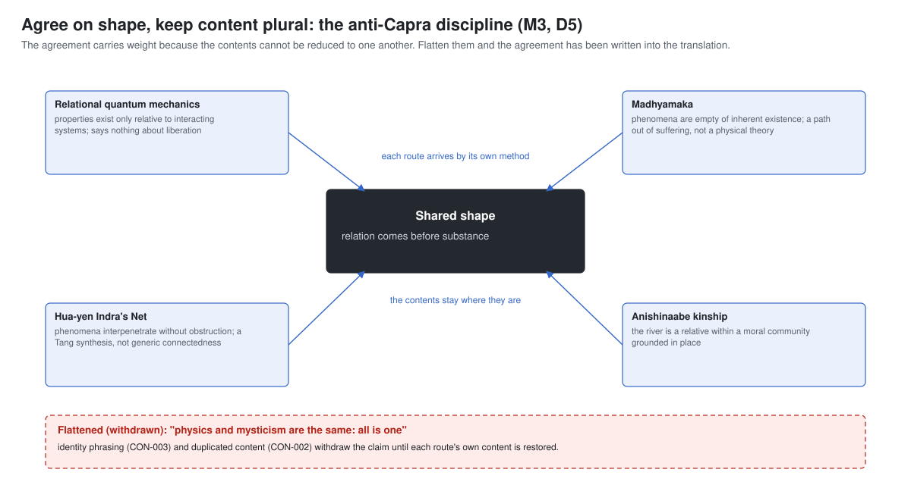
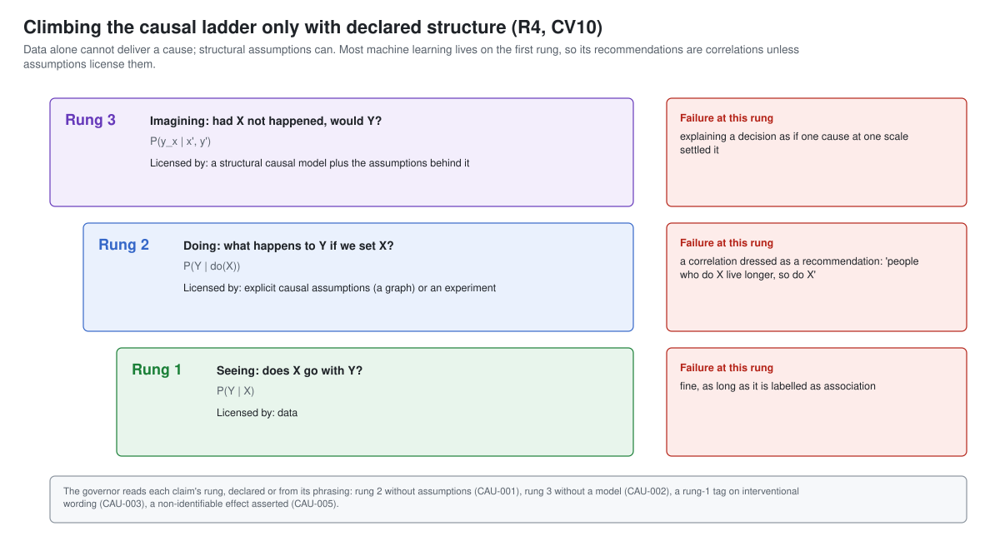

# The architecture

The threads are not one component. They are a discipline for how a system holds its claims,
counts its evidence, argues, weighs moral traditions and judges its own effects, placed at the
layer that can actually enforce each rule. This page describes the shape that discipline gives
a system.

## Eight strands, method first

| Strand | Lessons | Follows the book's | What it governs |
|---|---|---|---|
| M method | M1-M7 | Methodological Preface, Chapter 26, Epilogue | the standing of claims, independence of evidence, shape and content, open questions, own theses, limits, sources |
| R reality and explanation | R1-R6 | Part I (Chapters 1-5) | capability as configuration, hard-to-vary explanation, criticism, the causal ladder, scaling, levels |
| S self and cognition | S1-S8 | Part II (Chapters 6-10) | self-reports, self-description, deliberation labels, the selection environment, process over outcome, causal tracing, bias audits, debiasing structures |
| K cooperation and political economy | K1-K8 | Part III (Chapters 11-15) | reciprocity, reputation, commons, validity claims, cooperation's infrastructure, forecasting, surplus, the collective brain |
| D discourse and morals | D1-D7 | Part IV (Chapters 16-18) | mode declaration, points of defeat, positions, moral pluralism, fair sources, cultural defaults, the eight capacities |
| A artificial intelligence | A1-A13 | Part V (Chapters 19-24) | cycle effects, failure modes, deferral, the swarm, diversity, risk claims, reversibility, moral status, human worth, freedoms, gates, the discourse test, preference provenance |
| F four moves and institutions | F1-F7 | Part VI (Chapters 25-27) | two truths, action without attachment, Indra's Net, political economy, integration, pluriversal alignment, the seven moves |
| P practice | P1-P2 | Parts VII and VIII (Chapter 28, Epilogue) | the builder's open questions, prescriptions as hypotheses |

The order is the order of dependence. Every lesson above the method strand assumes it: a
causal claim needs a standing, a convergence needs independent routes, a moral answer needs
open disagreements kept open.

## Three ideas the architecture is built on

**A claim has a weight.** The book marks the standing of its paragraphs, and the threads make
standing a field on every claim. Wording follows standing: a contested claim is attributed, a
bridge is owned, a limit is stated where the claim would otherwise be read as stronger. This is
the register (M1), and the governor enforces it.

**Agreement is evidence only across independent routes.** Many sources repeating one source,
or many models trained alike, are one witness. Routes are recorded with their methods and
checked for shared upstream sources; the number of independent routes sets the ceiling on how
much the agreement can bear (M2). The book audits its own convergences this way and grades
them strong, partial or the author's thesis.

**Shape, not content.** When independent routes agree, what they share is a shape: relation
before substance, no view from nowhere, cooperation as basic. Their contents stay plural, and
merging them would destroy the evidence, because the independence of the contents is what made
the agreement informative (M3).

## Trust boundaries

1. **The model is a conjecture engine.** Its fluent output is conjecture until criticised; its
   reports about itself are testimony; its labels on its own claims are hypotheses. It drafts
   records; it does not certify them (R3, S1, S3).
2. **Checks live outside the model.** The governor, the assessor, the linter and the reviewers
   read the model's records and hold them to the lessons. A record that fails is returned with
   findings, never rendered as if it were fine.
3. **Some judgements belong to people.** Which traditions count as standpoints, who is
   consulted, whether a design's political economy is acceptable, whether the four questions
   are answered: these are human acts recorded in design reviews (A12, F4, P1).

## The governed answer

One answer, as `threadkit.governor.AnswerGovernor` handles it:

1. **Draft.** The model returns an answer record: mode, claims (standing, basis, rung, sources,
   forecast, risk), deliberation, disagreements, moral block, coverage.
2. **Schema.** The record must match the answer contract.
3. **Claims.** Each claim's wording is held to its standing; its basis to what it may support;
   numbers to primary sources; self-reports to independent checks; forecasts to windows; risk
   probabilities to their own sources (register lessons).
4. **Causes.** Each causal claim's rung is read, declared or from its phrasing; rung 2 needs
   assumptions, rung 3 a model (R4).
5. **Deliberation.** "Checked" needs a recorded check; an unchecked inference cannot be settled
   (S3, R3).
6. **Self-status.** No flat claim about the system's own consciousness or self (A8, S2).
7. **Mode.** Advocacy is disclosed; persuasion is not dressed as inquiry (D1, K4).
8. **Morals.** Foundational questions get attributed, plural answers and no default; traditions
   keep their own terms (D4, D5).
9. **Disagreements.** A cited disagreement is presented as contested (M4).
10. **Render or revise.** A healthy record is rendered with its standings visible; otherwise the
    findings, each naming its lesson, go back to the model for a bounded number of rounds.

## The four moves

The book's design framework (Chapter 25) is four habits of thought, each from a distinct
tradition and each answering one of the pressures of the present: two truths (act on what holds
in practice, keep the foundations open), action without attachment to its fruits (full
competence, no stake in the outcome or in one's own continuation, no retreat), Indra's Net (the
pattern of relations is the unit, and there is no standpoint outside it) and a political economy
that asks who gains and who pays. The book grades the framework as the author's own thesis, and
the threads keep that grade (CV9). The design review (`threadkit.review`) asks the four
questions together and flags any move standing alone (F5).

## Cooperation and the system's effects

Strands K, D and A turn the book's account of cooperation into review questions about a
deployment's effects: on the cognitive, institutional and narrative layers cooperation runs on
(K5); on the eight capacities people need (D7); on popular well-being, elite competition and
fiscal health (A1); on the three freedoms (A10) and the four commons (F4). Agents among agents
follow a published reciprocity policy (K1), carry reputation bound to lineage (K2), write to an
auditable shared medium (A4) and count each other's agreement by lineage (A5).

## Where the code is

| Concern | Module | Contract |
|---|---|---|
| standing, basis, sources, forecasts, risk, levels | `threadkit.register` | `claim` |
| the causal ladder | `threadkit.causal` | `claim` |
| independent routes and the anti-Capra discipline | `threadkit.convergence` | `convergence` |
| preserved disagreements | `threadkit.disagreements` | `disagreement` |
| hard-to-vary explanations | `threadkit.explanation` | `explanation` |
| mode, validity claims, points of defeat | `threadkit.argument` | `answer`, `dialogue` |
| moral pluralism | `threadkit.moral` | `answer` |
| debiasing structures | `threadkit.debias` | `decision-record` |
| reciprocity, reputation, commons | `threadkit.cooperation` | `agent-policy`, `design-review` |
| diversity-weighted consensus | `threadkit.consensus` | `consensus` |
| the four-move design review | `threadkit.review` | `design-review` |
| the governed answer | `threadkit.governor` | `answer` |
| the deployment audit | `threadkit.audit` | `deployment` |

## Relation to the other labs

The ai-ethics lab's compass governs what a system may believe and do (source and level tags, the
floor, the action ledger, authority chains). The threads govern how it reasons across
disciplines and traditions (standing, independence, shape and content, open questions, moral
pluralism) and how it judges its effects on the people and institutions around it. They are
designed to be used together: the compass's ledger is a ready-made writer for the shared-medium
log of A4, and the threads' register sits naturally on top of the compass's level tags.
