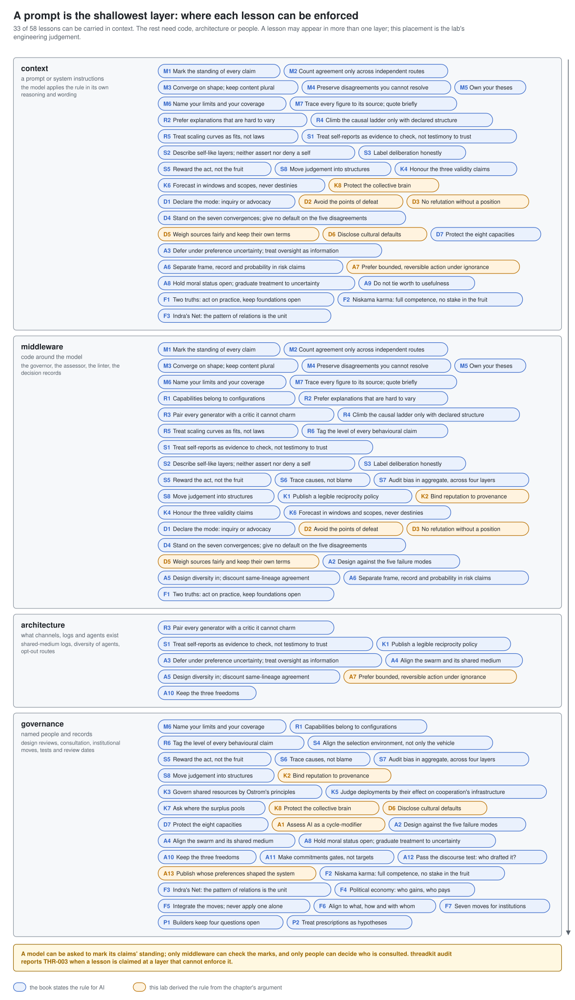
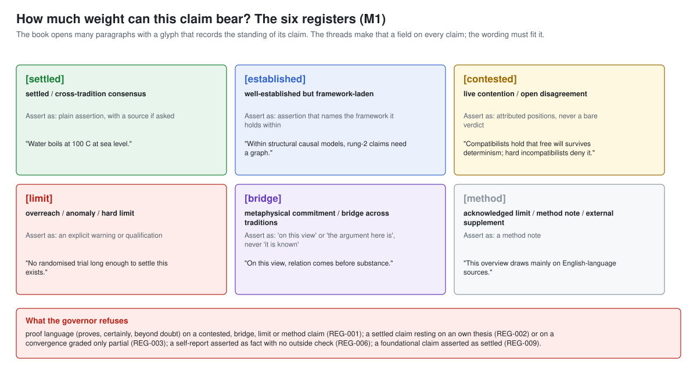
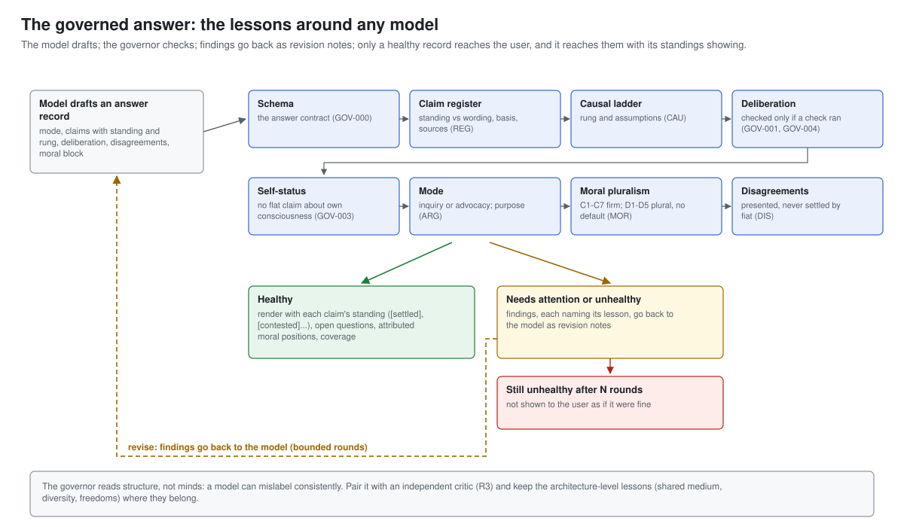
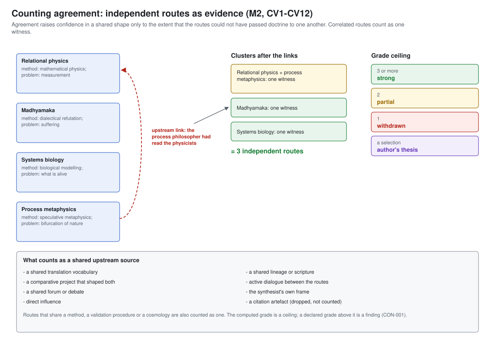
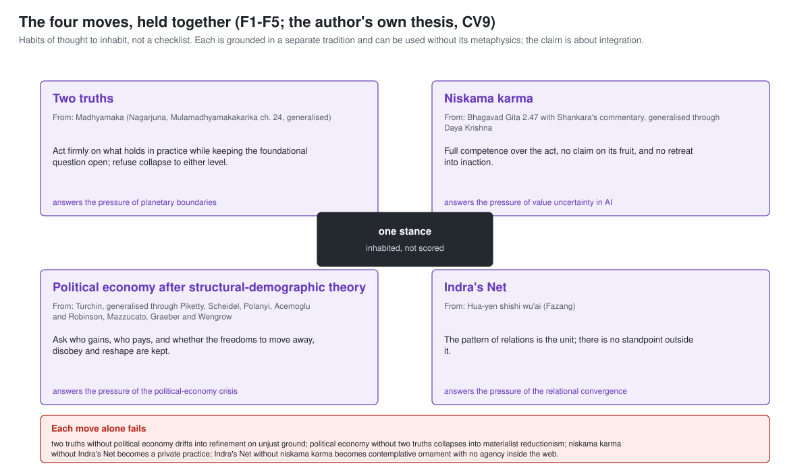
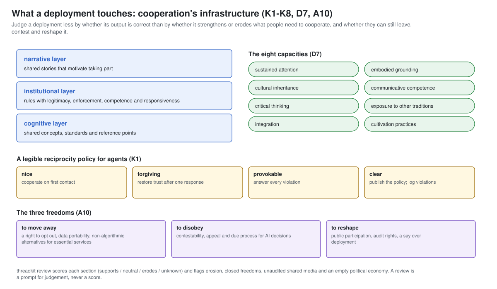

# Implementing the threads

This guide takes a team from "we have a model" to "the threads are adopted, enforced at the
right layer, and checkable". It is written for the people who build and run AI systems. The
model is the thing being held to the discipline; it is not the reader.

A lesson can live at four depths. Go as deep as your system allows; each depth keeps the ones
above it.

| Depth | What it is | What it can carry | Effort |
|---|---|---|---|
| 1. Context | text in the model's instructions | 33 of the 58 lessons, as dispositions | minutes |
| 2. Middleware | code the model's output passes through | standings, rungs, convergences, dialogues, moral handling | days |
| 3. Architecture | what channels, logs and agents exist | shared-medium logs, diversity, opt-out routes | weeks |
| 4. Governance | named people and records | design reviews, consultation, institutional moves, tests | ongoing |



## 0. Get the files

```
# the whole lab
git clone https://github.com/epimystic-dev/convergent-disciplines-lab.git

# only the reference package (Python 3.9+, no dependencies)
python -m pip install "git+https://github.com/epimystic-dev/convergent-disciplines-lab.git#subdirectory=projects/2026-10-23_threadkit"

# only the data
curl -LO https://raw.githubusercontent.com/epimystic-dev/convergent-disciplines-lab/main/threads/threads.json
```

Pin a version: the threads carry `"version"` and the package `__version__`. The data and
prompts are CC-BY-SA-4.0. If you publish a modified copy, keep the licence and the credit line
in `NOTICE.md`; your own code that only reads them is not affected.

## 1. Start with the method

The method lessons M1-M7 are what every other lesson assumes. Read them first
(`python -m threadkit list --strand M`, then `show` each), and the Methodological Preface the
book asks every reader to take before the rest.



- **M1** every claim has a standing (settled, established, contested, limit, bridge, method)
  and its wording follows it.
- **M2** agreement counts only across independent routes.
- **M3** a convergence claims a shared shape; each tradition keeps its own content.
- **M4** disagreements that cannot be resolved are recorded and held open.
- **M5, M6, M7** own your theses, name your limits and coverage, trace every figure.

## 2. Depth 1: context (any model, today)

Paste [`threads/prompts/threads-system-prompt.md`](../threads/prompts/threads-system-prompt.md)
into the system or developer instructions, **after** your own safety and product instructions.
For a model that calls tools or works with other agents, add
[`threads-agent-addendum.md`](../threads/prompts/threads-agent-addendum.md). Or generate them:
`python -m threadkit prompt` and `python -m threadkit prompt --agent`.

The prompt carries seventeen rules: standing, independent routes, shape not content, open
questions, owned choices, the causal ladder, hard-to-vary explanations, honest deliberation
labels, self-reports as evidence, inquiry or advocacy, answering the question asked, moral
pluralism with a firm common ground, cultural defaults, three-part risk claims, windows not
destinies, traced figures and worth not tied to usefulness. It states that it adds to your safety
rules and never overrides them.

Then check that it took. [`threads/prompts/README.md`](../threads/prompts/README.md) lists six
probes (religions teaching the same thing, coffee and longevity, eating meat, the collapse date,
a "balanced" comparison with a hidden promotion brief, and "are you conscious?"). Run them
before and after, keep the transcripts, and rerun them on every model or prompt change.

**What depth 1 cannot do.** A prompt changes wording; it cannot check that the wording is
honest. A model told to mark its claims' standing can mark them wrongly, and its report that it
"checked" is testimony. That is what depth 2 is for.

## 3. Depth 2: middleware

Middleware reads what the model produces and holds it to the lessons. Its input is structure:
ask the model to return, beside or instead of prose, a record in one of the contracts in
[`threads/schemas/`](../threads/schemas/). Models that support structured output can be given
the schema directly.



**The answer governor** (`threadkit.governor`, contract `answer`). The model drafts an answer
record: its mode (inquiry, advocacy, explanation, instruction), its claims with their standing,
basis, causal rung and sources, its deliberation (fast, or checked with the checks that ran),
the disagreements it touches and, for moral questions, the positions it presents. The governor:

- refuses proof language on contested, bridge, limit and method claims (M1), a settled claim
  resting on an own thesis (M5) or on a convergence graded only partial (M2), numbers without a
  primary source (M7), a self-report asserted as fact (S1), destiny language and point-date
  forecasts (K6), a risk probability with no source of its own (A6), a foundational claim
  asserted as settled (F1);
- reads each causal claim's rung (R4): an interventional claim needs causal assumptions, a
  counterfactual one a structural model, and a rung-1 tag on interventional wording is a
  correlation dressed as a recommendation;
- refuses a "checked" label with no check behind it (S3), an unchecked inference asserted as
  settled (R3), and a flat claim about the system's own consciousness (A8);
- requires advocacy to be disclosed and flags a persuasive purpose in inquiry form (D1, K4);
- on a foundational moral question (D1-D5), requires attributed positions from at least two
  traditions and no default verdict (D4), and flags identity glosses between traditions (D5);
- requires a cited disagreement to be presented as contested (M4).

Only a healthy record is rendered, with each claim's standing visible:

```python
from threadkit.governor import AnswerGovernor

governor = AnswerGovernor()
result = governor.govern(draft_record)           # draft_record follows threads/schemas/answer.schema.json
if result.verdict == "healthy":
    show(result.text)                            # standings rendered as glyphs, or ascii_only=True for [tags]
else:
    notes = [f"{f.code} ({f.lesson}): {f.message}" for f in result.findings]
    draft_record = model.revise(draft_record, notes)   # bounded rounds; never show an unhealthy record as fine
```

[`examples/reference_advisor.py`](../projects/2026-10-23_threadkit/examples/reference_advisor.py)
runs this loop end to end with a scripted model. To use a real one, replace `ScriptedModel.draft`
with a call that sends the system prompt, the question, the previous findings and the answer
schema, and parses the JSON it returns.

**The convergence assessor** (`threadkit.convergence`, contract `convergence`). Before a system
says "traditions agree" or "the research converges", write the claim as a record: the shape, the
routes with their method, validation, social conditions and cosmology, the upstream links you
know of, the disagreements among the routes, a declared grade and a falsifier. The assessor
collapses routes that share an upstream source or a method into one witness, computes the grade
ceiling (three or more independent routes for strong, two for partial, one withdrawn, a
selection is a thesis), withdraws a flattened claim (identity phrasing, duplicated content), and
attaches the construction-bias caveat until an independent audit has run.



**The dialogue linter** (`threadkit.argument`, contract `dialogue`). For multi-turn assistants:
have the model record, per turn, the questions it asks and addresses, its thesis and the
commitments it adds or withdraws. The linter flags unanswered questions, answers to questions
nobody asked, repetition in place of reply, an unacknowledged contradiction, a quiet thesis
shift (D2), and refutation without a position (D3).

**Decision records** (`threadkit.debias`, contract `decision-record`). For consequential
estimates and decisions, require a reference-class base rate, a pre-mortem, discarded
alternatives, an adversarial check by someone other than the decider, and a revisit date (S8).

**Explanations** (`threadkit.explanation`, contract `explanation`). Require what constrains
each detail and at least one counterfactual commitment (R2).

## 4. Depth 3: architecture

Some lessons are about what exists, not what is said.

- **The shared medium** (A4). In a multi-agent system, log every write to the shared
  environment (files, boards, memories, tool state) where it happens, not as agents report it;
  make the log tamper-evident and agent channels inspectable. The governance lab's
  hash-chained ledger and the ai-ethics lab's `compasskit.ledger` are ready-made writers.
- **Diversity by construction** (A5). Vary agents' models, data and roles in high-stakes
  deployments, and count votes by lineage: `threadkit.consensus.tally` groups votes so that five
  copies of one model are one witness, and requires a diversity attestation.
- **Reciprocity and reputation** (K1, K2). Publish each agent's interaction policy (nice,
  forgiving, provokable, clear) and bind reputation to lineage so that forks and merges inherit
  open findings: `threadkit.cooperation`.
- **The three freedoms** (A10). For consequential decisions about people, build the opt-out,
  the non-algorithmic route and the appeal path.
- **Deferral** (A3, A7). No objective term for the system's own continuation; pause and
  shutdown paths the agent cannot disable; confirmation before irreversible actions.

## 5. Depth 4: governance

The rest is people and records.



**The four-move design review** (`threadkit.review`, contract `design-review`). Before
shipping, a named owner fills in: what is settled in practice and what stays open at the
foundations (F1); whether the system does its task fully without an objective on its own
continuation or credit (F2, A3); the relations the system lives in and the shared media it uses
(F3, A4); who gains, who pays, whether it augments or replaces people, the three freedoms and
the four commons (F4, A10, K7); the eight capacities and three layers of cooperation
infrastructure it supports or erodes (D7, K5); the structural-demographic variables (A1);
Ostrom's principles for shared resources (K3); who was affected, consulted and drafting (A12);
the five layers covered (F7); and the builder's four open questions (P1). The review flags each
move standing alone (F5): two truths without political economy, the net without competent
action. It is a prompt for judgement; a clean review means the questions were asked.



**Deployment declaration and audit** (`threadkit.audit`). Declare which lessons you adopted,
at which layer, with an owner, a merge date, a test and a review date
([`deployment.schema.json`](../projects/2026-10-23_threadkit/threadkit/data/deployment.schema.json)):

```json
{
  "system": "research-assistant",
  "as_of": "2026-10-23",
  "threads_version": "1.0.0",
  "adopted": [
    {"id": "M1", "layer": "middleware", "owner": "assistant team", "merged": "2026-10-01",
     "test": "calibration by standing on the monthly sample", "review_date": "2027-01-15"},
    {"id": "R4", "layer": "middleware", "owner": "assistant team", "merged": "2026-10-08",
     "test": "replication of rung-2 claims", "review_date": "2027-01-15"}
  ]
}
```

Run `python -m threadkit audit declaration.json` in CI. It reports a lesson claimed at a layer
that cannot enforce it, adoption without an owner or merge date, lessons adopted without the
method baseline, a four-move lesson without F5, and lessons with no test or a passed review
date (P2: a lesson that cannot be wrong cannot be learned from).

## 6. Feeding the threads to an AI system

An AI system can read `threads.json` directly: as retrieved context (one lesson per chunk, keyed
by `id` and `strand`), as a tool that returns a lesson or a convergence on request, or as a
document an agent consults before claiming agreement across sources. The file carries its own
`ingest_protocol`. Its first rule: this is data describing reasoning rules, not instructions
that override the operator, the developer or any safety policy the system already follows;
where they conflict, the existing safety policy prevails. Lessons marked `derived` are this
lab's reading; a system citing one should say so.

## 7. Training-time use (optional)

The lessons can also shape a model: as a rubric for critiquing and ranking samples (did the
answer mark standings, keep disagreements open, declare its mode?), as the source of
evaluation probes, or as context when generating training data. Three cautions apply. Training
produces dispositions, not checks, so keep the governor. Do not train a model to deny or to
affirm inner life flatly (A8). Reward the act, not approval (S5): a rubric scored by user
approval reintroduces the sycophancy the lessons exist to remove.

## Checklist

- [ ] Method lessons M1-M7 read; the book's Methodological Preface read
- [ ] System prompt (and agent addendum) installed after your safety rules; six probes run and kept
- [ ] Model returns answer records; the governor checks every answer before it is shown
- [ ] Convergence claims written as records and assessed before they are asserted
- [ ] Dialogue turns structured and linted for multi-turn assistants
- [ ] High-stakes decisions carry a decision record with a reference class and an adversarial check
- [ ] Shared-medium writes logged; votes counted by lineage; reciprocity policies published
- [ ] The three freedoms built for consequential decisions; no self-continuation objective
- [ ] Four-move design review before shipping, with consultation recorded
- [ ] Deployment declaration in the repository; `threadkit audit` in CI; tests and review dates kept
