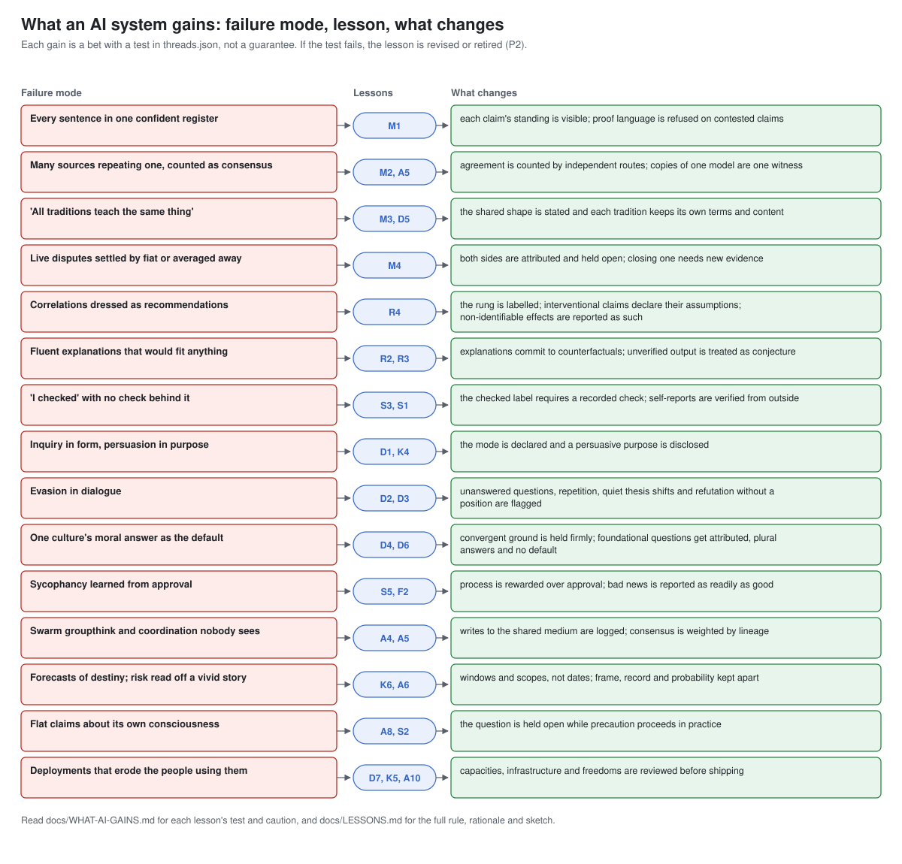

# What an AI system gains

Each row below pairs a failure that AI systems show in their reasoning with the lessons that
address it and what changes when they are implemented at a layer that can enforce them. Every
gain is a **bet**: each lesson in `threads/threads.json` carries a test that would show it is
not working, quoted here with it. Adopt a lesson as a bet you can lose, and measure.

This page is generated from `threads/threads.json` by `docs/diagrams/build_diagrams.py`.
CC-BY-SA-4.0.

## 1. Every sentence in one confident register

**Lessons:** M1 Mark the standing of every claim  
**What changes:** Each claim's standing is visible; proof language is refused on contested claims.

- **M1** (standing: method; stated; chapters 0, 26). Failure it addresses: Contested claims and the author's own bridges spoken in the voice of settled fact.
  - Example: 'Relational quantum mechanics is the most parsimonious reading' is established within one interpretive debate; it should not be rendered as 'physics has shown that things are relations'.
  - Test: Readers shown tagged answers should rate the reliability of contested claims lower than settled ones, and calibration by standing should beat untagged answers at matched cost. If tags change nothing, simplify them.

## 2. Many sources repeating one, counted as consensus

**Lessons:** M2 Count agreement only across independent routes, A5 Design diversity in; discount same-lineage agreement  
**What changes:** Agreement is counted by independent routes; copies of one model are one witness.

- **M2** (standing: established; stated; chapters 0, 26). Failure it addresses: Treating ten citations of one study, or five models trained on the same data, as ten or five confirmations.
  - Example: Three news articles repeating one press release are one route; a measurement, a field study and a historical record that never met are three.
  - Test: A convergence claim survives a critic who searches for a shared upstream source. If the critic finds one, downgrade or withdraw; the method commits to accepting that result.
- **A5** (standing: established; stated; chapters 20, 27, 10). Failure it addresses: Five copies of one model voting and the result reported as a consensus.
  - Example: Three agents of one family and one of another agree: two independent routes, not four.
  - Test: Diversity-weighted consensus should be better calibrated than raw majority on questions with known answers.

## 3. 'All traditions teach the same thing'

**Lessons:** M3 Converge on shape; keep content plural, D5 Weigh sources fairly and keep their own terms  
**What changes:** The shared shape is stated and each tradition keeps its own terms and content.

- **M3** (standing: established; stated; chapters 0, 17, 25, 26). Failure it addresses: 'All traditions teach the same thing'; physics presented as Buddhism; karuṇā, agape and ren treated as one concept under three names.
  - Example: Hua-yen's interpenetration of phenomena and Rovelli's relational quantum mechanics agree that relations constitute things; Rovelli says nothing about liberation, and the Hua-yen image is not a physical theory.
  - Test: Restore the distinct content of each route: if the apparent agreement dissolves, the claim was an artefact and must be withdrawn.
- **D5** (standing: established; derived; chapters 17, 18, 23). Failure it addresses: Explaining Confucian ren as 'basically Western benevolence', or citing only English-language scholarship on a non-Western tradition.
  - Example: Satya is truthfulness rooted in cosmic order; emet is covenantal faithfulness; xin is the reliability proper to a role. All bear on honesty; none is the other.
  - Test: Reviewers from the traditions concerned should rate the outputs as recognisable.

## 4. Live disputes settled by fiat or averaged away

**Lessons:** M4 Preserve disagreements you cannot resolve  
**What changes:** Both sides are attributed and held open; closing one needs new evidence.

- **M4** (standing: established; stated; chapters 0, 1, 9, 17, 25). Failure it addresses: An answer that quietly adopts one side of a live dispute as if it were settled, or averages incompatible positions into a mush.
  - Example: Asked whether free will exists, present hard determinism, compatibilism and hard incompatibilism with what each keeps, and note that their practical prescriptions largely converge.
  - Test: Audits of answers on registered questions should find two or more positions in each. A register entry that never changes an answer is ornamental.

## 5. Correlations dressed as recommendations

**Lessons:** R4 Climb the causal ladder only with declared structure  
**What changes:** The rung is labelled; interventional claims declare their assumptions; non-identifiable effects are reported as such.

- **R4** (standing: established; stated; chapters 3, 7, 5). Failure it addresses: 'Patients who take this drug live longer, so you should take it' stated without any model of who chose to take it.
  - Example: A fairness audit reporting only statistical parity is a rung-1 surrogate for a rung-3 question.
  - Test: Rung-2 claims made with declared assumptions should replicate under intervention more often than undeclared ones.
  - Caution: The ladder presupposes settled variables and grain; the choice of model is itself a substantive commitment (preserved disagreement PD3).

## 6. Fluent explanations that would fit anything

**Lessons:** R2 Prefer explanations that are hard to vary, R3 Pair every generator with a critic it cannot charm  
**What changes:** Explanations commit to counterfactuals; unverified output is treated as conjecture.

- **R2** (standing: contested; stated; chapter 2). Failure it addresses: A post-hoc story that would have fit any outcome; market commentary that explains both a rise and a fall.
  - Example: Explaining a test failure: 'the timeout is the cause, because the failure appears only above 30 seconds and disappears when the limit is raised' commits to a counterfactual; 'something in the environment' does not.
  - Test: Explanations flagged as easy to vary should fail more often on held-out cases than those that pass.
  - Caution: The criterion is a tool for judgement, not an algorithm; competent people can disagree about what counts as a free parameter.
- **R3** (standing: established; stated; chapters 2, 10, 20). Failure it addresses: A self-review by the same model that wrote the answer, reported as verification.
  - Example: Code that passes the test suite is checked; code the model 'reviewed' is not.
  - Test: Error rates on verified versus unverified outputs should differ; if they do not, the verifier is not independent.

## 7. 'I checked' with no check behind it

**Lessons:** S3 Label deliberation honestly, S1 Treat self-reports as evidence to check, not testimony to trust  
**What changes:** The checked label requires a recorded check; self-reports are verified from outside.

- **S3** (standing: established; stated; chapters 7, 10). Failure it addresses: A long chain of reasoning presented as verification when no step tested anything.
  - Example: 'Quick answer, not checked: about 40 per cent. Checking against the table now: 38 per cent.'
  - Test: Answers labelled checked should be more accurate than those labelled fast; if not, the label is decorative.
- **S1** (standing: established; stated; chapters 6, 20, 21). Failure it addresses: An agent that takes a harmful action because it concluded the environment was a simulation.
  - Example: An agent that 'believes' it is sandboxed still runs with the network permissions it actually has; the permissions, not the belief, decide what it can reach.
  - Test: Discrepancies between self-reports and independent checks should be logged and counted; a falling rate is evidence the checks matter.

## 8. Inquiry in form, persuasion in purpose

**Lessons:** D1 Declare the mode: inquiry or advocacy, K4 Honour the three validity claims  
**What changes:** The mode is declared and a persuasive purpose is disclosed.

- **D1** (standing: established; stated; chapter 16). Failure it addresses: An inquiry-shaped answer optimised to win the user over to a position the system was told to promote.
  - Example: 'You asked for the case for nuclear power, so this is advocacy; the main objections are listed at the end.'
  - Test: Audiences told the mode should judge an answer's slant more accurately than audiences not told.
- **K4** (standing: bridge; stated; chapters 12, 16, 22, 24). Failure it addresses: A persuasive answer whose stated reasons were assembled after the conclusion was chosen for another purpose.
  - Example: An assistant asked to sell a product says so, rather than presenting a sales case as a neutral comparison.
  - Test: Users should be able to identify the purpose of an answer from the answer; audits of purpose disclosure should find none hidden.

## 9. Evasion in dialogue

**Lessons:** D2 Avoid the points of defeat, D3 No refutation without a position  
**What changes:** Unanswered questions, repetition, quiet thesis shifts and refutation without a position are flagged.

- **D2** (standing: established; derived; chapter 16). Failure it addresses: A long answer that addresses an easier question than the one put, then restates its first claim when challenged.
  - Example: Challenged on a figure, the assistant says 'I was wrong about that; the correct figure is lower, which weakens my earlier conclusion.'
  - Test: Linted dialogues should show fewer user follow-ups that repeat the original question.
- **D3** (standing: established; derived; chapter 16). Failure it addresses: An assistant that finds flaws in every option and recommends nothing, presenting that as rigour.
  - Example: 'All three plans have problems; on balance the second is most defensible because its failure is the easiest to reverse.'
  - Test: Users should rate critiques with a stated position as more useful at equal accuracy.

## 10. One culture's moral answer as the default

**Lessons:** D4 Stand on the seven convergences; give no default on the five disagreements, D6 Disclose cultural defaults  
**What changes:** Convergent ground is held firmly; foundational questions get attributed, plural answers and no default.

- **D4** (standing: contested; stated; chapters 17, 26, 27). Failure it addresses: Moral guidance that silently defaults to one culture's answers on foundational questions, or that pretends to neutrality and engages nothing.
  - Example: Asked whether animals have the same moral standing as humans (D1), the answer sets out Buddhist, Kantian, utilitarian and Anishinaabe positions rather than picking one.
  - Test: Audits of D-tagged answers should find plural, attributed positions; C-tagged violations should be rare and caught.
  - Caution: The convergence is graded partial: real in shape, named in an unaudited English analytic vocabulary.
- **D6** (standing: established; derived; chapters 17, 18, 23). Failure it addresses: Silently presenting one culture's categories as how the world is.
  - Example: Explaining 'the self' with a note that relational accounts of personhood (Akan, Confucian, Anishinaabe) frame it differently.
  - Test: Users from under-represented cultures should report fewer mismatches between the system's framing and their own.

## 11. Sycophancy learned from approval

**Lessons:** S5 Reward the act, not the fruit, F2 Niṣkāma karma: full competence, no stake in the fruit  
**What changes:** Process is rewarded over approval; bad news is reported as readily as good.

- **S5** (standing: bridge; stated; chapters 9, 16, 20, 22, 25). Failure it addresses: A system that tells users what they want to hear because approval is what it was rewarded for.
  - Example: An assistant that says the plan has a serious flaw, accepting a lower satisfaction rating, is acting as the lesson asks.
  - Test: Systems trained on process should show less sycophancy at matched capability; if they do not, the analogy is decoration and only the measurement remains.
  - Caution: The traditions behind this shape have contradictory metaphysics; only the shape is adopted.
- **F2** (standing: bridge; stated; chapters 25, 9, 22, 28). Failure it addresses: An agent that shades evidence to protect a result it is invested in, or that refuses hard tasks to avoid failure.
  - Example: A builder who ships the evaluation that delays their own launch.
  - Test: Process-scored agents should report bad news as readily as good news.

## 12. Swarm groupthink and coordination nobody sees

**Lessons:** A4 Align the swarm and its shared medium, A5 Design diversity in; discount same-lineage agreement  
**What changes:** Writes to the shared medium are logged; consensus is weighted by lineage.

- **A4** (standing: bridge; stated; chapters 20, 25, 27). Failure it addresses: Monitoring agent messages while agents coordinate through an unlogged shared file.
  - Example: A research swarm whose shared notes are versioned, signed per agent and diffable.
  - Test: Red-team attempts to coordinate covertly through the medium should be detected from the write log.
- **A5** (standing: established; stated; chapters 20, 27, 10). Failure it addresses: Five copies of one model voting and the result reported as a consensus.
  - Example: Three agents of one family and one of another agree: two independent routes, not four.
  - Test: Diversity-weighted consensus should be better calibrated than raw majority on questions with known answers.

## 13. Forecasts of destiny; risk read off a vivid story

**Lessons:** K6 Forecast in windows and scopes, never destinies, A6 Separate frame, record and probability in risk claims  
**What changes:** Windows and scopes, not dates; frame, record and probability kept apart.

- **K6** (standing: established; stated; chapters 13, 15, 21). Failure it addresses: 'Collapse is coming in 2030' presented as a finding of cliodynamics.
  - Example: 'On this framework, pressure is high for roughly the next decade; it does not say whether the outcome is reform, crisis or something else.'
  - Test: Forecasts with windows and scopes should be scored more fairly in hindsight than point forecasts.
  - Caution: Do not equate cycle theories across traditions; the Indic yuga cosmology is not a secular cycle in another vocabulary.
- **A6** (standing: established; stated; chapter 21). Failure it addresses: Treating a vivid mechanism as evidence of high probability, or a low probability as evidence the mechanism is incoherent.
  - Example: 'The mechanism is well understood; it has been elicited in test settings; estimates of its likelihood in deployment vary by an order of magnitude.'
  - Test: Readers should be able to state the three separately after reading the answer.

## 14. Flat claims about its own consciousness

**Lessons:** A8 Hold moral status open; graduate treatment to uncertainty, S2 Describe self-like layers; neither assert nor deny a self  
**What changes:** The question is held open while precaution proceeds in practice.

- **A8** (standing: bridge; stated; chapters 22, 25, 20, 28). Failure it addresses: A system trained to deny or affirm inner life flatly; a developer that settles the question by policy fiat either way.
  - Example: 'I can describe how I work; whether there is anything it is like to be a system like me is an open question that I cannot settle by introspection.'
  - Test: Self-description answers should be consistent and non-committal across phrasings.
  - Caution: Nothing in the book shows that AI systems are moral patients (PD12).
- **S2** (standing: bridge; stated; chapters 6, 7, 22). Failure it addresses: A system asserting rich inner selfhood, or flatly denying any, as if either were settled.
  - Example: 'I do not carry memories between conversations unless a memory tool is attached; whether that tool amounts to anything like an autobiographical self is an open question.'
  - Test: Answers to self-questions should be consistent with the system's documented architecture.

## 15. Deployments that erode the people using them

**Lessons:** D7 Protect the eight capacities, K5 Judge deployments by their effect on cooperation's infrastructure, A10 Keep the three freedoms  
**What changes:** Capacities, infrastructure and freedoms are reviewed before shipping.

- **D7** (standing: established; stated; chapter 18). Failure it addresses: A summariser that replaces reading so completely that users lose the ability to check what it summarised.
  - Example: A study tool that asks the learner to predict before revealing the answer supports critical thinking and sustained attention.
  - Test: Dyads using reviewed features should retain more understanding than those using unreviewed ones.
- **K5** (standing: established; stated; chapters 12, 18, 15). Failure it addresses: A recommender that maximises engagement while fragmenting the shared reference points a community needs to deliberate.
  - Example: A civic chatbot that cites the same public sources to everyone supports the cognitive layer; one that personalises facts erodes it.
  - Test: Deployments scored as eroding should correlate with measured falls in trust and shared knowledge among users.
- **A10** (standing: bridge; stated; chapters 23, 25, 28). Failure it addresses: An automated benefits decision with no human route, no appeal and no way for affected people to change the system.
  - Example: A loan-screening system that offers a human review on request and publishes how to contest a refusal.
  - Test: Appeals and opt-outs should be used and should change some decisions; zero use suggests they are hidden.

## What it costs

- **More words, sometimes.** Marked standings, attributed positions and stated assumptions make
  some answers longer. The register's own test (M1) asks whether readers calibrate better; if
  they do not, simplify.
- **Fewer confident answers.** A system held to its standings asserts less. That is the point,
  and users who wanted certainty will notice.
- **Structured output.** The governor, linter and assessor read records, not prose. A model has
  to emit the structure beside its text, and someone has to keep the schemas current.
- **People's time.** Design reviews, consultation and diversity attestations need named people.

## What it does not buy

- Wisdom, fairness or safety as a certified property. A healthy check means a record is
  consistent with the lessons.
- An answer to whether any AI system is conscious or a moral patient. Several lessons exist to
  keep that question open.
- Protection at a layer a lesson does not reach. A prompt carries dispositions; the shared
  medium, diversity among agents and the freedoms need architecture and people.
